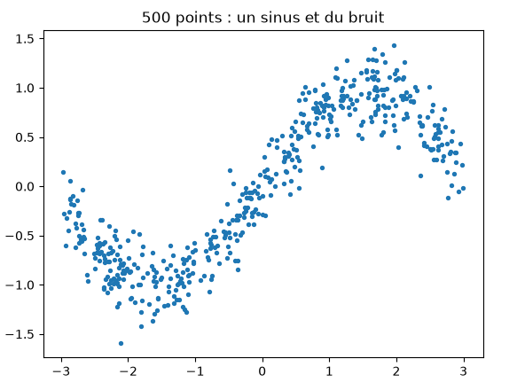
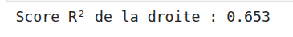
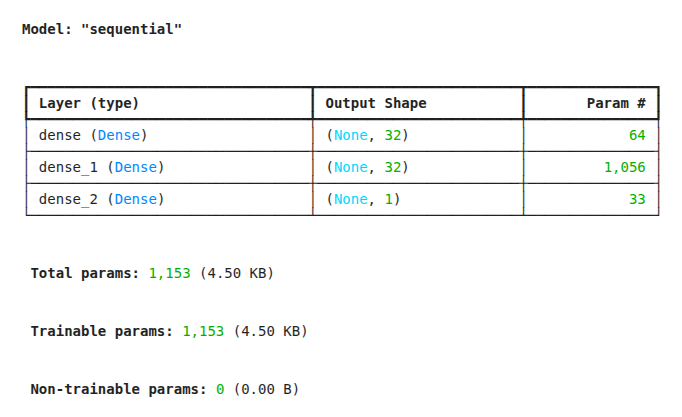
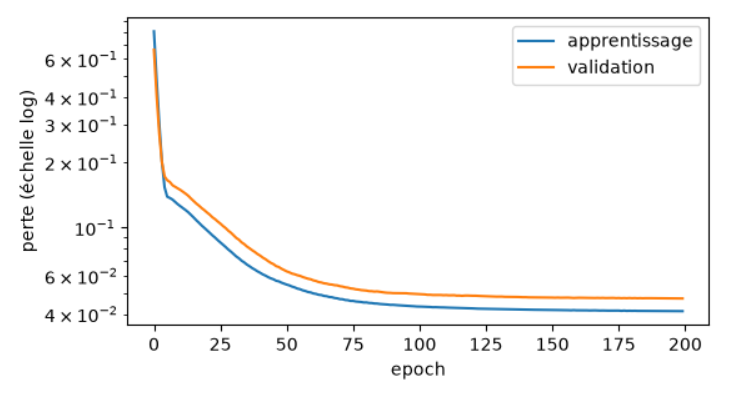
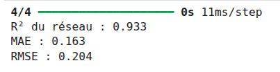
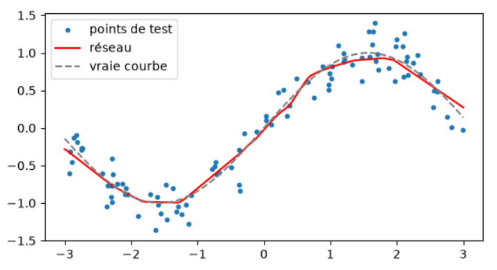
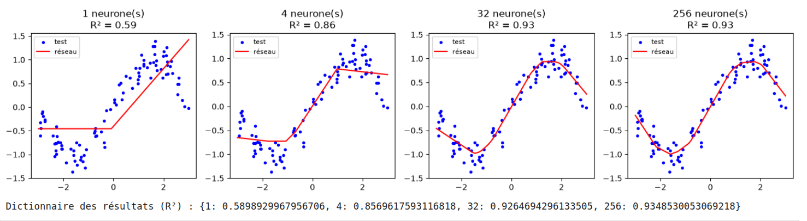
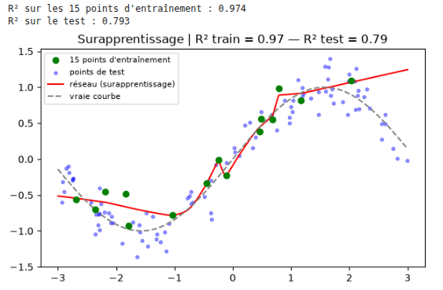
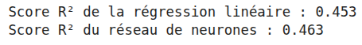

#  Cours : Prédire un nombre — La régression avec un réseau de neurones

## 1. Introduction : Qu'est-ce que la régression ?

En Machine Learning et en Deep Learning, on distingue deux grandes familles de tâches supervisées :

* **La classification** : Prédire une catégorie, une classe (ex: *Est-ce un chat ou un chien ?*, *Spam ou non ?*).
* **La régression** : Prédire une valeur continue, c'est-à-dire un **nombre** (ex: *Prédire un prix immobilier*, *Estimer une température*, ou ici, *prédire la hauteur `y` d'une courbe à partir de sa position `x`*).

---

## 2. Étape 1 & 2 — La préparation des données : Non-linéarité et Découpage

Pour bien comprendre pourquoi les réseaux de neurones sont puissants, on commence par générer des données synthétiques qui ne suivent pas une simple ligne droite, mais une fonction sinusoïdale bruitée.

### Génération et visualisation
```python
import numpy as np
import matplotlib.pyplot as plt

# Fixer la graine aléatoire pour la reproductibilité
rng = np.random.default_rng(42)

# Génération des positions x et des hauteurs y (un sinus + du bruit)
x = rng.uniform(-3, 3, 500)
y = np.sin(x) + rng.normal(0, 0.2, 500)

plt.scatter(x, y, s=8)
plt.title("500 points : un sinus et du bruit")
plt.show()
```



### Le découpage (Train / Test) et le remodelage (Reshape)
Avant de nourrir un modèle Keras, deux actions indispensables sont menées :

1. **Le passage à 2 dimensions (Le `reshape`)** :
   *  **Éclairage théorique** : Keras et TensorFlow attendent systématiquement des entrées sous forme de matrice (lignes, colonnes) de type `(batch_size, features)`. Notre vecteur `x` d'origine est un simple tableau 1D de taille `(500,)`. On le transforme en une colonne unique de forme `(500, 1)` grâce à `reshape(-1, 1)`. Même si nous n'avons qu'une seule variable en entrée, le réseau a besoin de cette structure matricielle pour effectuer ses multiplications de poids.

2. **Le découpage (Train / Test)** : 
   * On met 20 % des données de côté (`x_test`, `y_test`). Le réseau ne les verra *jamais* pendant son apprentissage ; elles serviront de **verdict final** pour évaluer sa capacité de généralisation sur des situations inédites.

```python
from sklearn.model_selection import train_test_split

# Remodelage pour obtenir un tableau à 2 dimensions (500 lignes, 1 colonne)
x = x.reshape(-1, 1)

# Découpage : 80% pour l'entraînement, 20% pour le test
x_train, x_test, y_train, y_test = train_test_split(x, y, test_size=0.2, random_state=42)
```

---

## 3. Étape 3 — La référence (Baseline) : La régression linéaire

En IA, avant de construire une architecture complexe (comme un réseau de neurones profond), il est impératif de tester une **méthode simple** pour établir une référence (une *baseline*). Si un réseau complexe fait moins bien ou à peine mieux qu'une droite, c'est qu'il y a un problème !

* **Le score R² (Coefficient de détermination)** : Il mesure la part de variance expliquée par le modèle.
  * $R^2 = 1$ : Prédiction parfaite.
  * $R^2 = 0$ : Le modèle n'est pas mieux que de prédire systématiquement la moyenne des valeurs.
  * $R^2 < 0$ : Le modèle est pire que tout prédire à la moyenne.

```python
from sklearn.linear_model import LinearRegression
from sklearn.metrics import r2_score

# Initialisation et entraînement de la régression linéaire
modele_lineaire = LinearRegression()
modele_lineaire.fit(x_train, y_train)

# Prédiction et évaluation sur le jeu de test
y_pred_lineaire = modele_lineaire.predict(x_test)
r2_lineaire = r2_score(y_test, y_pred_lineaire)

print("Score R² de la droite :", round(r2_lineaire, 3))
```



> *Observation pédagogique :* Une droite ne pouvant pas courber son tracé, elle s'arrête à un score $R^2$ modéré (autour de $0.65$). Elle souffre de **sous-apprentissage structurel** face à la forme en vague d'un sinus.

---

## 4. Étape 4 & 5 — Conception et entraînement du Réseau de Neurones

### Les spécificités d'un réseau de régression

Contrairement à la classification binaire (où la dernière couche utilise une fonction d'activation `sigmoid` pour forcer la sortie entre 0 et 1) :

1. **Pas d'activation sur la dernière couche** : La couche de sortie comporte un seul neurone **sans fonction d'activation**, car elle doit pouvoir prédire *n'importe quel nombre réel* (positif ou négatif).
   
3. **La fonction de perte (Loss) : La MSE (Mean Squared Error)** :
   
    * **Éclairage théorique** : On calcule la moyenne des carrés des écarts entre les valeurs réelles et les prédictions. Élever au carré pénalise très fortement les grosses erreurs, poussant le réseau à se corriger rapidement.
      
5. **La métrique MAE (Mean Absolute Error)** :
   
    * Contrairement à la MSE, la MAE mesure l'erreur absolue moyenne (sans mise au carré), ce qui est beaucoup plus intuitif à interpréter directement dans l'unité de la variable cible $y$.

###  L'arme secrète : La fonction d'activation ReLU
Dans les couches cachées, l'utilisation de `activation="relu"` (Rectified Linear Unit, $f(x) = \max(0, x)$) est fondamentale. C'est elle qui casse la linéarité : en combinant des morceaux de droites, le réseau parvient à "sculpter" une courbe capable d'épouser le signal sinusoïdal.

### Construction du modèle dans Keras
```python
from tensorflow import keras
from tensorflow.keras import layers

keras.utils.set_random_seed(42)

# Définition de l'architecture séquentielle
modele = keras.Sequential([
    layers.Input(shape=(1,)),                # 1 seule caractéristique en entrée (x)
    layers.Dense(32, activation="relu"),     # 1ère couche cachée de 32 neurones (non-linéarité ReLU)
    layers.Dense(32, activation="relu"),     # 2ème couche cachée de 32 neurones
    layers.Dense(1)                          # Couche de sortie : 1 seul neurone, SANS activation
])

# Compilation du modèle
modele.compile(
    optimizer="adam",                        # Optimiseur adaptatif ultra-performant
    loss="mse",                              # Perte adaptée à la régression
    metrics=["mae"]                          # Suivi de l'erreur absolue moyenne
)

modele.summary()
```


> *Note sur l'optimiseur Adam* : On peut voir l'optimiseur comme un randonneur les yeux bandés qui cherche à descendre au fond d'une vallée pour trouver l'erreur minimale. Adam ajuste dynamiquement la taille de ses pas pour éviter de stagner ou de rater la zone optimale.

### L'entraînement (`model.fit`)
Durant l'entraînement, on définit des **epochs** (passages complets sur le dataset). Le paramètre `validation_split=0.2` met automatiquement 20 % des données d'entraînement de côté à chaque epoch pour surveiller le comportement du modèle sur des données qu'il n'utilise pas pour ajuster ses poids.

```python
histoire = modele.fit(
    x_train, y_train,
    epochs=200,
    batch_size=32,
    validation_split=0.2,
    verbose=0 # Masque les affichages superflus par epoch
)
print("Entraînement terminé avec succès !")
```

---

## 5. Étape 6 — Analyse de la courbe de perte (Loss)

Il est crucial de tracer l'évolution de la perte au fil des epochs (en échelle logarithmique pour mieux observer la décroissance) à la fois sur les données d'entraînement et de validation.

```python
plt.figure(figsize=(6, 3.2))
plt.plot(histoire.history["loss"], label="apprentissage")
plt.plot(histoire.history["val_loss"], label="validation")
plt.yscale("log")
plt.xlabel("epoch")
plt.ylabel("perte (échelle log)")
plt.legend()
plt.show()
```



> * **Analyse critique** : La courbe de validation (orange) suit fidèlement la courbe d'apprentissage et se stabilise généralement autour des epochs 100 à 125. Pousser jusqu'à 200 epochs n'était mathématiquement plus nécessaire, le modèle ayant atteint sa convergence.

---

## 6. Étape 7 & 8 — Évaluation finale et Visualisation

Une fois l'entraînement terminé, on évalue la performance globale sur le jeu de test, en combinant plusieurs indicateurs complémentaires :

```python
from sklearn.metrics import mean_absolute_error

# Prédictions sur le test (on aplatit le tableau avec .ravel())
y_pred = modele.predict(x_test).ravel()

r2_reseau = r2_score(y_test, y_pred)
mae = mean_absolute_error(y_test, y_pred)
rmse = np.sqrt(np.mean((y_test - y_pred) ** 2))

print(f"R² du réseau : {r2_reseau:.3f}")
print(f"MAE : {mae:.3f}")
print(f"RMSE : {rmse:.3f}")
```



> * **Résultat typique** : Le score $R^2$ grimpe au-delà de $0.93$, écrasant largement la performance de la simple droite ($0.65$). Le réseau a réussi à épouser la forme sinusoïdale grâce aux fonctions d'activation non-linéaires (`relu`) de ses couches cachées.

### Visualisation finale : Le réseau vs La réalité
```python
xs = np.linspace(-3, 3, 300).reshape(-1, 1)

plt.figure(figsize=(6.5, 3.4))
plt.scatter(x_test, y_test, s=10, label="points de test")
plt.plot(xs, modele.predict(xs, verbose=0), color="red", label="réseau")
plt.plot(xs, np.sin(xs), "--", color="gray", label="vraie courbe (sans bruit)")
plt.legend()
plt.show()
```



---

---

## 7. Étape 9 — Expérience : Combien de neurones faut-il ?

Un réseau trop petit ne peut pas suivre la courbe : c'est le **sous-apprentissage** (*underfitting*). Mesurons-le en faisant varier le nombre de neurones dans une unique couche cachée.

### Le protocole expérimental
Pour des réseaux à une seule couche cachée de **1, 4, 32 puis 256 neurones** (avec 200 epochs, un batch size de 32, et sans validation), on calcule le score $R^2$ sur le jeu de test et on stocke le tout dans un dictionnaire `resultats`[cite: 9].

```python
resultats = {}
plt.figure(figsize=(14, 3.5))

neurones_list = [1, 4, 32, 256]

for i, n in enumerate(neurones_list):
    # Fixer la graine à chaque tour pour comparer à armes égales
    keras.utils.set_random_seed(42)
    
    # Construction dynamique du modèle avec 'n' neurones
    modele_exp = keras.Sequential([
        layers.Input(shape=(1,)),
        layers.Dense(n, activation="relu"),
        layers.Dense(1)
    ])
    
    modele_exp.compile(optimizer="adam", loss="mse")
    
    # Entraînement (200 epochs, sans validation)
    modele_exp.fit(x_train, y_train, epochs=200, batch_size=32, verbose=0)
    
    # Évaluation sur le test
    y_pred_exp = modele_exp.predict(x_test, verbose=0).ravel()
    score_r2 = r2_score(y_test, y_pred_exp)
    resultats[n] = score_r2
    
    # Traçage des courbes côte à côte
    plt.subplot(1, 4, i + 1)
    plt.scatter(x_test, y_test, s=8, label="test", color="blue")
    
    xs = np.linspace(-3, 3, 300).reshape(-1, 1)
    plt.plot(xs, modele_exp.predict(xs, verbose=0), color="red", label="réseau")
    
    plt.title(f"{n} neurone(s)\nR² = {score_r2:.2f}")
    plt.legend(loc="upper left", fontsize=8)

plt.tight_layout()
plt.show()

print("Dictionnaire des résultats (R²) :", resultats)
```


**Analyse des graphiques obtenus** :

* **1 neurone** ($R^2 \approx 0.59$) : Le réseau se résume à deux morceaux de droites assemblés (effet ReLU). C'est beaucoup trop simple pour épouser la vague sinusoïdale : on observe un net **sous-apprentissage**.
* **4 neurones** ($R^2 \approx 0.86$) : La courbe commence à s'articuler et à suivre grossièrement la forme générale.
* **32 & 256 neurones** ($R^2 \approx 0.93$) : Le réseau dispose de suffisamment de segments linéaires combinés pour sculpter une courbe fluide qui épouse parfaitement la tendance des données. Au-delà, ajouter encore plus de neurones (256) n'apporte plus de gain significatif sur ce type de signal simple.


## 8. Étape 10 — Expérience : Trop peu de données (Surapprentissage)

Cette fois c'est l'inverse : on utilise un **gros réseau** (2 couches de 256 neurones) mais avec **très peu de données**. Il peut alors mémoriser chaque point, bruit compris : c'est le **surapprentissage** (*overfitting*)[cite: 10].

### Le protocole expérimental
N'utilisez que les **15 premiers points** de `x_train` / `y_train`. Entraînez le gros réseau **500 epochs** (batch 8). Calculez `r2_train` (sur ces 15 points) et `r2_test` (sur tout le test), puis tracez la courbe prédite[cite: 10].

> 💡 **Indice** : Découpez avec `x_train[:15]`. Comparez les deux $R^2$ : que valent-ils chacun ?[cite: 10]

```python
# Calcul de r2_train et r2_test avec seulement 15 points
x_train_15 = x_train[:15]
y_train_15 = y_train[:15]

keras.utils.set_random_seed(42)

modele_overfit = keras.Sequential([
    layers.Input(shape=(1,)),
    layers.Dense(256, activation="relu"),
    layers.Dense(256, activation="relu"),
    layers.Dense(1)
])

modele_overfit.compile(optimizer="adam", loss="mse")
modele_overfit.fit(x_train_15, y_train_15, epochs=500, batch_size=8, verbose=0)

y_pred_train_15 = modele_overfit.predict(x_train_15, verbose=0).ravel()
r2_train = r2_score(y_train_15, y_pred_train_15)

y_pred_test = modele_overfit.predict(x_test, verbose=0).ravel()
r2_test = r2_score(y_test, y_pred_test)

print(f"R² sur les 15 points d'entraînement : {r2_train:.3f}")
print(f"R² sur le test : {r2_test:.3f}")

# Traçage
plt.figure(figsize=(7, 4))
plt.scatter(x_train_15, y_train_15, color="green", label="15 points d'entraînement", zorder=5)
plt.scatter(x_test, y_test, color="blue", s=10, label="points de test", alpha=0.4)

xs = np.linspace(-3, 3, 300).reshape(-1, 1)
plt.plot(xs, modele_overfit.predict(xs, verbose=0), color="red", label="réseau (surapprentissage)")
plt.plot(xs, np.sin(xs), "--", color="gray", label="vraie courbe")

plt.title(f"Surapprentissage | R² train = {r2_train:.2f} — R² test = {r2_test:.2f}")
plt.legend(fontsize=8)
plt.show()
```



❓ **Question** : Comparez $R^2$ d'entraînement et $R^2$ de test. Que vous dit l'écart ? Que faudrait-il pour le réduire ?  
*Réponse* : Le $R^2$ d'entraînement (0.97) est supérieur au $R^2$ de test (0.79), ce qui met en évidence un surapprentissage : le modèle a mémorisé les points d'entraînement spécifiques au lieu de généraliser. Pour réduire cet écart, il faudrait augmenter la quantité de données d'entraînement ou intégrer des techniques de régularisation.  

---

## 9. Étape 11 — Sur des données réelles : La progression du diabète

Reprenons toute la démarche sur un vrai jeu de données : `load_diabetes` (442 patients, 10 mesures médicales, cible = indice de progression de la maladie). Ici les 10 colonnes ont des échelles différentes : il faut les **mettre à l'échelle**, en calculant la moyenne et l'écart-type **sur l'apprentissage seul**.  

### Le protocole expérimental
1. Découpez (20 % de test, `random_state=42`) vers `Xd_train`, `Xd_test`, `yd_train`, `yd_test`.  
2. Standardisez (`StandardScaler` : `fit` sur train, `transform` sur train et test).  
3. Régression linéaire $\rightarrow$ `r2_lin_d`.  
4. Réseau **16 puis 8 neurones**, 150 epochs max, batch 16, validation 20 %, **arrêt précoce** (patience 15, `restore_best_weights=True`) $\rightarrow$ `r2_res_d`.  

```python
from sklearn.datasets import load_diabetes
from sklearn.linear_model import LinearRegression
from sklearn.preprocessing import StandardScaler

diabetes = load_diabetes()
Xd_d, yd_d = diabetes.data, diabetes.target

Xd_train, Xd_test, yd_train, yd_test = train_test_split(Xd_d, yd_d, test_size=0.2, random_state=42)

scaler = StandardScaler()
Xd_train_scaled = scaler.fit_transform(Xd_train)
Xd_test_scaled = scaler.transform(Xd_test)

# 1. Modèle linéaire de référence
modele_lin_d = LinearRegression()
modele_lin_d.fit(Xd_train_scaled, yd_train)
yd_pred_lin = modele_lin_d.predict(Xd_test_scaled)
r2_lin_d = r2_score(yd_test, yd_pred_lin)

# 2. Réseau de neurones avec EarlyStopping
keras.utils.set_random_seed(42)

modele_res_d = keras.Sequential([
    layers.Input(shape=(Xd_train_scaled.shape[1],)),
    layers.Dense(16, activation="relu"),
    layers.Dense(8, activation="relu"),
    layers.Dense(1) # Sortie unique pour la régression
])

modele_res_d.compile(optimizer="adam", loss="mse")

early_stopping = keras.callbacks.EarlyStopping(
    monitor="val_loss",
    patience=15,
    restore_best_weights=True
)

modele_res_d.fit(
    Xd_train_scaled, yd_train,
    epochs=150,
    batch_size=16,
    validation_split=0.2,
    callbacks=[early_stopping],
    verbose=0
)

yd_pred_res = modele_res_d.predict(Xd_test_scaled, verbose=0).ravel()
r2_res_d = r2_score(yd_test, yd_pred_res)

print(f"Score R² de la régression linéaire : {r2_lin_d:.3f}")
print(f"Score R² du réseau de neurones : {r2_res_d:.3f}")
```


**Question** : Le réseau bat-il nettement la régression linéaire ? Pourquoi l'avantage est-il faible sur ce jeu ?

  *Réponse* : Non, le réseau ne bat pas nettement la régression linéaire, les scores $R^2$ étant très proches (environ 0.45 contre 0.46). Cet avantage minime s'explique par le fait que les relations dans ce jeu de données médical sont en grande partie linéaires, et que la taille restreinte de l'échantillon ne permet pas à un réseau de neurones de surperformer massivement.

---

## Ce qu'il faut retenir

* **Régression** = prédire un nombre : sortie sans activation, perte MSE, mesures MAE / RMSE / $R^2$.  
* Le **$R^2$** se lit par rapport à une référence : $0$ = pas mieux que la moyenne, $1$ = parfait. Comparez **toujours** à une méthode simple.  
* **Trop petit** = sous-apprentissage ; **trop gros pour trop peu de données** = surapprentissage.

## 10. Conclusion & Mot de la fin

Ce TP illustre à merveille le changement de paradigme entre les statistiques traditionnelles et le Deep Learning :

1. **De la ligne globale au sur-mesure local** : Alors qu'une régression linéaire cherche une contrainte globale rigide (une droite), le réseau de neurones combine des fonctions non-linéaires pour modeler une courbe au plus près de la complexité des données réelles.
2. **Le piège de la complexité (Overfitting)** : Si l'on avait donné une architecture démesurée (ex: des centaines de neurones) à ce petit jeu de données bruité, le réseau aurait pu faire du *sur-apprentissage* (apprendre le bruit aléatoire par cœur au lieu de capter la tendance générale du sinus). Tout l'art du Deep Learning réside dans cet équilibre subtil entre la capacité du modèle et la quantité/qualité des données disponibles.

>  **Ressource associée** : Tu peux retrouver et télécharger le notebook complet de ce TP directement sur GitHub :
> 👉 <a href="https://github.com/GregoryElBajoury/deep-learning-workshops/blob/main/enonces/ENONCES/tp1_regression.ipynb" target="_blank" rel="noopener noreferrer">Accéder au notebook<code>tp1_regression.ipynb</code></a>
