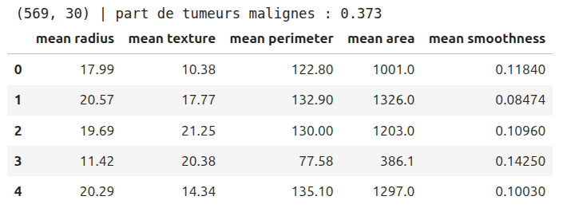
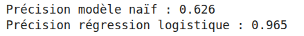
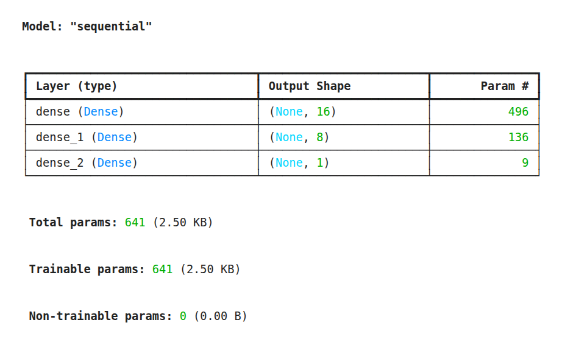
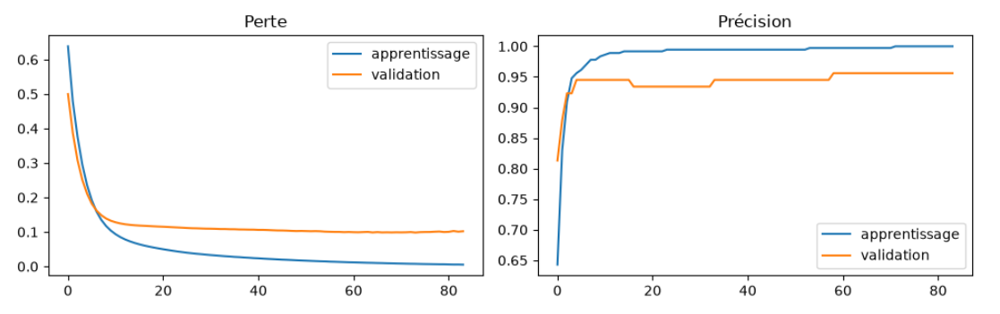
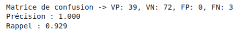
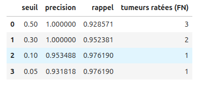
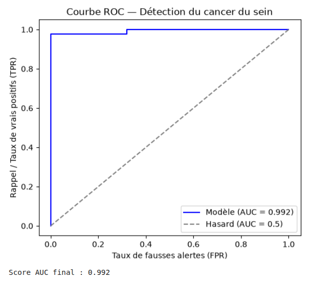

# TP2 — Répondre par oui ou non : La classification binaire

Dans le TP précédent, nous avons abordé la régression, c'est-à-dire l'art de prédire une valeur numérique continue (par exemple, estimer un prix ou une température).

Dans ce deuxième TP, nous changeons de paradigme pour entrer dans le monde de la classification binaire. Ici, le modèle ne cherche plus à deviner un chiffre, mais à prendre une décision tranchée entre deux choix possibles (généralement codés $0$ et $1$) :

- S'agit-il d'un e-mail spam ($1$) ou légitime ($0$) ?
- Cette transaction bancaire est-elle frauduleuse ($1$) ou normale ($0$) ?
- Cette tumeur détectée est-elle maligne ($1$) ou bénigne ($0$) ? C'est précisément ce cas d'application clinique que nous allons étudier aujourd'hui.

---

## 1. Charger et préparer les données

Pour ce TP, nous allons utiliser un jeu de données classique en apprentissage automatique : le jeu de données *Breast Cancer* (fourni directement par la bibliothèque `scikit-learn`). Il contient 569 échantillons et 30 mesures morphologiques calculées à partir de radiographies de cellules mammaires (taille, texture, périmètre, etc.).

### Pourquoi inverser la cible ?
Par défaut, dans ce jeu de données, la cible (ce que le modèle doit deviner) est étiquetée ainsi :

- `0` = Tumeur maligne
- `1` = Tumeur bénigne

Pour un être humain, cela peut sembler logique alphabétiquement (Maligne vs Bénin inversé par scikit-learn), mais pour un algorithme, c'est contre-intuitif. En IA, la classe que l'on cherche à détecter en priorité (l'alarme, le risque, la maladie) est traditionnellement appelée la **classe positive** et se voit attribuer la valeur **`1`**.

C'est pourquoi nous allons inverser les étiquettes : 

nous posons $y = 1 - \text{data.target}$ pour que **$1$ corresponde désormais à une tumeur maligne** et $0$ à une tumeur bénigne.

```python
from sklearn.datasets import load_breast_cancer
import pandas as pd

# Chargement des données brutes depuis scikit-learn
data = load_breast_cancer()
X = data.data        # Les caractéristiques (features) : les 30 mesures morphologiques
y = 1 - data.target  # Inversion de la cible pour que 1 = tumeur maligne (classe d'intérêt)

# Affichage des dimensions de la matrice et de la proportion de cas positifs
print(X.shape, "| part de tumeurs malignes :", round(y.mean(), 3))

# Aperçu des 5 premières colonnes du DataFrame pour visualiser les caractéristiques
pd.DataFrame(X[:, :5], columns=data.feature_names[:5]).head()
```



---

## 2. Découpage et standardisation (Attention au Data Leakage)

Avant de confier ces données à un réseau de neurones, il y a deux étapes méthodologiques cruciales à respecter rigoureusement pour ne pas fausser l'apprentissage :

1. **Le découpage (Train/Test)** : On sépare nos données en un ensemble d'entraînement (`X_train`, `y_train`) pour faire apprendre le modèle, et un ensemble de test (`X_test`, `y_test`) gardé strictement secret pour évaluer ses performances finales sur des cas qu'il n'a jamais vus. L'argument `stratify=y` est vital ici : il garantit que la proportion de tumeurs malignes et bénignes est rigoureusement la même dans le jeu d'entraînement et dans le jeu de test.
2. **La standardisation (Mise à l'échelle)** : Les réseaux de neurones détestent manipuler des variables aux échelles trop disparates (par exemple, une aire mesurée en milliers d'unités aux côtés d'une texture mesurée en dixièmes). Le `StandardScaler` centre chaque colonne pour que sa moyenne soit égale à $0$ et son écart-type à $1$.

> ⚠️ **Règle d'or en IA (Pas de Data Leakage)** : On calcule la moyenne et l'écart-type **uniquement sur le jeu d'entraînement** (`fit_transform`), puis on applique ces mêmes paramètres sur le jeu de test (`transform`).
Si l'on normalisait tout le paquet d'un coup avant de découper, de l'information statistique du futur jeu de test "fuirait" vers le jeu d'entraînement : c'est le **Data Leakage** (fuite de données), qui fausse complètement l'évaluation du modèle.

```python
from sklearn.model_selection import train_test_split
from sklearn.preprocessing import StandardScaler

# Séparation des données : 80% pour l'apprentissage, 20% pour le test final
X_train, X_test, y_train, y_test = train_test_split(
    X, y, test_size=0.2, stratify=y, random_state=42
)

# Normalisation des caractéristiques pour stabiliser l'apprentissage du réseau
scaler = StandardScaler()
X_train = scaler.fit_transform(X_train) # Apprentissage de la moyenne/écart-type sur le train uniquement
X_test = scaler.transform(X_test)       # Application de la même transformation sur le test
```

---

## 3. Les références à battre : Les Baselines

En Machine Learning, on ne juge jamais la performance d'un modèle dans le vide. Un score de $90\%$ de réussite a l'air impressionnant, mais si le jeu de données contient majoritairement des cas bénins, un modèle idiot qui répondrait toujours "bénin" atteindrait un score élevé sans rien apprendre.

C'est pourquoi on calcule toujours des **baselines** (références) :

1. **Le modèle naïf** : Il prédit systématiquement la classe majoritaire observée dans l'entraînement.
2. **La Régression Logistique** : Un modèle linéaire simple et robuste. Si notre réseau de neurones profond fait moins bien qu'une simple régression logistique, c'est qu'il y a un problème de conception ou d'apprentissage.

```python
from sklearn.linear_model import LogisticRegression

# Calcul de la précision d'un modèle naïf (qui prédit toujours la classe la plus fréquente)
acc_betise = max(y_train.mean(), 1 - y_train.mean())

# Entraînement d'une régression logistique de référence
modele_logistique = LogisticRegression(max_iter=2000)
modele_logistique.fit(X_train, y_train)

# Évaluation de la régression logistique sur le jeu de test
acc_logistique = modele_logistique.score(X_test, y_test)

print(f"Précision modèle naïf : {acc_betise:.3f}")
print(f"Précision régression logistique : {acc_logistique:.3f}")
```



---

## 4. Construction et entraînement du réseau de neurones

Passons maintenant au Deep Learning avec Keras. Pour faire de la classification binaire, l'architecture du réseau change par rapport à la régression :

- **La couche de sortie** : Elle ne comporte qu'**un seul neurone**.
- **La fonction d'activation de sortie** : C'est une **sigmoïde** (`activation="sigmoid"`). Sa particularité mathématique est de compresser n'importe quel nombre réel en une valeur comprise strictement entre **$0$ et $1$**. On peut ainsi interpréter cette sortie comme une **probabilité** (par exemple : *"Il y a 87% de chances que cette tumeur soit maligne"*).
- **La fonction de perte (Loss)** : On utilise la `binary_crossentropy` (entropie croisée binaire). C'est la fonction de coût mathématiquement idéale pour pénaliser un modèle qui attribue de fortes probabilités à la mauvaise classe.
- **L'arrêt précoce (*Early Stopping*)** : Plutôt que de fixer un nombre d'époques arbitraire au risque de faire du surapprentissage (*overfitting*), on demande au modèle de s'arrêter tout seul dès que l'erreur sur les données de validation cesse de s'améliorer.

```python
from tensorflow import keras
from tensorflow.keras import layers

# Fixation de la graine aléatoire pour assurer la reproductibilité des résultats d'un run à l'autre
keras.utils.set_random_seed(42)

# Définition de l'architecture séquentielle du réseau
modele = keras.Sequential([
    layers.Input(shape=(30,)),             # Couche d'entrée correspondant à nos 30 caractéristiques
    layers.Dense(16, activation="relu"),   # Première couche cachée (extraction de motifs non linéaires)
    layers.Dense(8, activation="relu"),    # Deuxième couche cachée (synthèse des caractéristiques)
    layers.Dense(1, activation="sigmoid")  # Sortie unique : probabilité (entre 0 et 1) que la tumeur soit maligne
])

# Compilation du modèle : association de l'optimiseur Adam, de la perte binaire et de l'accuracy
modele.compile(
    optimizer="adam",
    loss="binary_crossentropy",
    metrics=["accuracy"]
)

# Affichage du récapitulatif de l'architecture et du nombre de paramètres
modele.summary()
```



---

## 5. Entraîner avec arrêt précoce

Dans l'apprentissage d'un réseau de neurones, le choix du nombre d'époques (le nombre de tours complets sur le jeu d'entraînement) est délicat : 

- S'il y en a trop, le modèle risque le **surapprentissage (*overfitting*)** : il commence à "apprendre par cœur" les bruits et les spécificités du jeu d'entraînement au lieu de généraliser, ce qui détériore ses performances sur les données qu'il ne connaît pas.
- S'il n'y en a pas assez, le modèle sera en **sous-apprentissage (*underfitting*)** et n'aura pas exploité tout son potentiel.

Pour résoudre ce dilemme de façon dynamique et élégante, nous mettons en place le callback `EarlyStopping`. 

### Comment ça fonctionne ?
1. **L'indice surveillé (`monitor="val_loss"`)** : On observe à chaque époque la fonction de perte calculée sur l'ensemble de validation (`val_loss`). Contrairement à l'exactitude (*accuracy*) qui peut stagner par paliers, la perte est un indicateur fin et continu de la progression de l'erreur du modèle.
2. **La patience (`patience=10`)** : Le modèle s'autorise à faire du surplace ou à stagner pendant 10 époques consécutives. Si aucune amélioration de la perte de validation n'est constatée après ce délai, l'entraînement est interrompu net, ce qui évite de gâcher du temps de calcul et préserve la capacité de généralisation du modèle.
3. **La restauration automatique (`restore_best_weights=True`)** : C'est l'option magique ! Lorsque l'arrêt précoce se déclenche à l'époque $N$, le modèle se trouve souvent dans un état légèrement dégradé par rapport au pic de performance atteint quelques époques plus tôt. Cet argument demande à Keras de remonter dans le temps et de réinjecter les poids exacts de la meilleure époque enregistrée.

```python
early_stopping = keras.callbacks.EarlyStopping(
    monitor="val_loss",    # On surveille la perte sur l'ensemble de validation
    patience=10,           # Nombre d'époques à attendre sans amélioration avant d'arrêter
    restore_best_weights=True  # Restaure les poids du modèle au moment de sa performance optimale
)

# Lancement de l'entraînement du réseau
histoire = modele.fit(
    X_train, y_train,
    epochs=100,            # Nombre maximum d'itérations prévu
    batch_size=16,         # Nombre d'échantillons traités avant chaque mise à jour des poids
    validation_split=0.2,  # 20% du jeu d'entraînement est mis de côté pour valider à chaque époque
    callbacks=[early_stopping],
    verbose=0              # verbose=0 pour masquer les logs ligne par ligne dans la console
)

print("Entraînement avec arrêt précoce terminé avec succès !")
```

---

## 6. L'analyse des courbes d'apprentissage

Visualiser les courbes d'apprentissage permet de vérifier si le modèle apprend correctement et s'il ne souffre pas de surapprentissage (divergence entre train et validation).

### Pourquoi tracer ces courbes ?
Regarder uniquement le score final à la fin de l'entraînement ne suffit pas. Les graphiques de l'évolution de la perte (*loss*) et de la précision (*accuracy*) au fil des époques sont de véritables tableaux de bord pour diagnostiquer la santé de votre réseau de neurones :

1. **La courbe de Perte (`Loss`)** : 
   - Elle doit diminuer régulièrement à la fois sur l'ensemble d'apprentissage et sur l'ensemble de validation. 
   - Si la perte d'apprentissage continue de descendre tandis que la perte de validation se met à remonter, c'est le signal d'alarme incontestable du **surapprentissage (*overfitting*)** : le modèle mémorise le jeu d'entraînement mais perd sa capacité à généraliser.
2. **La courbe de Précision (`Accuracy`)** :
   - Elle doit augmenter progressivement pour converger vers un plateau haut. 
   - L'écart entre la courbe d'apprentissage (bleue) et la courbe de validation (orange) indique si le modèle est robuste : un écart trop large (validation nettement en dessous) traduit un déséquilibre ou un manque de régularisation.

```python
import matplotlib.pyplot as plt

h = histoire.history
fig, ax = plt.subplots(1, 2, figsize=(10, 3.2))

# Courbe de la fonction de perte (Loss)
ax[0].plot(h["loss"], label="apprentissage")
ax[0].plot(h["val_loss"], label="validation")
ax[0].set_title("Perte (Loss)")
ax[0].legend()

# Courbe de la précision (Accuracy)
ax[1].plot(h["accuracy"], label="apprentissage")
ax[1].plot(h["val_accuracy"], label="validation")
ax[1].set_title("Précision (Accuracy)")
ax[1].legend()

plt.tight_layout()
plt.show()
```



---

## 7. La matrice de confusion, calculée à la main

L'exactitude globale (*accuracy*) est une mesure trompeuse, en particulier dans les contextes médicaux ou critiques où les classes sont parfois déséquilibrées. Un modèle qui prédit toujours la classe majoritaire peut afficher une excellente *accuracy* tout en étant totalement inutile.

Pour analyser finement la nature des erreurs commises par notre réseau de neurones, on utilise la **matrice de confusion**. Plutôt que d'utiliser une boîte noire de scikit-learn, nous allons la coder et la calculer explicitement à l'aide de tableaux `NumPy` pour bien comprendre chaque composante.

### Les 4 quadrants de la matrice de confusion
Imaginons que notre classe positive (1) soit "Tumeur Maligne" et la classe négative (0) soit "Tumeur Bénin" :

1. **VP (Vrais Positifs)** : Le modèle prédit *Malin* et, en réalité, c'était bien *Malin*. (Succès de détection)
2. **VN (Vrais Négatifs)** : Le modèle prédit *Bénin* et, en réalité, c'était bien *Bénin*. (Succès de diagnostic sain)
3. **FP (Faux Positifs)** : Le modèle prédit *Malin* alors qu'en réalité c'était *Bénin*. C'est une **fausse alerte** (le patient subit un stress psychologique et des examens complémentaires inutiles).
4. **FN (Faux Négatifs)** : Le modèle prédit *Bénin* alors qu'en réalité c'était *Malin*. C'est **l'erreur la plus critique en médecine** : on rate une tumeur maligne et le patient n'est pas pris en charge à temps.

### Les indicateurs dérivés clés
À partir de ces quatre compteurs, on calcule deux métriques fondamentales qui s'opposent et se complètent :

- **La Précision** = $\frac{VP}{VP + FP}$ : 
  * *Définition* : Parmi tous les cas que le modèle a déclarés comme étant malins, quelle proportion était réellement maligne ?
  * *Utilité* : Elle mesure la **fiabilité des alertes**. Une haute précision signifie peu de fausses alarmes.

- **Le Rappel (ou Sensibilité)** = $\frac{VP}{VP + FN}$ : 
  * *Définition* : Parmi toutes les véritables tumeurs malignes présentes dans la population de test, quelle proportion le modèle a-t-il réussi à dépister ?
  * *Utilité* : Elle mesure la **capacité de couverture**. Un haut rappel signifie qu'on ne laisse passer presqu'aucune maladie.

```python
import numpy as np

# Récupération des probabilités prédites sur le test, puis conversion en classes (seuil par défaut à 0.5)
proba = modele.predict(X_test, verbose=0).ravel()
pred = (proba >= 0.5).astype(int)

# Calcul manuel des différents cas de la matrice de confusion avec NumPy
VP = np.sum((pred == 1) & (y_test == 1))
VN = np.sum((pred == 0) & (y_test == 0))
FP = np.sum((pred == 1) & (y_test == 0))
FN = np.sum((pred == 0) & (y_test == 1))

# Calcul des indicateurs dérivés
precision = VP / (VP + FP)
rappel = VP / (VP + FN)

print(f"Matrice de confusion -> VP: {VP}, VN: {VN}, FP: {FP}, FN: {FN}")
print(f"Précision : {precision:.3f}")
print(f"Rappel : {rappel:.3f}")
```




> 💡 *Réflexion métier* : Un **faux négatif** (laisser passer une tumeur maligne) est l'erreur critique absolue en oncologie, tandis qu'un faux positif engendre une simple alerte à vérifier. Le choix des métriques aide à arbitrer ces risques.

>  **Question de réflexion** : 
> *Dans ce contexte médical, quelle erreur est la plus grave : le faux positif ou le faux négatif ? Que disent vos chiffres ?*
> 
> *Réponse :* Dans ce contexte médical, le faux négatif est le plus grave car il correspond à une tumeur maligne non détectée, ce qui prive le patient d'un traitement vital.

> Nos chiffres indiquent quelques faux négatifs, ce qui signifie que le modèle a raté certains cas potentiels de cancer.

---


## 8. Déplacer le seuil de décision

Par défaut, notre réseau de neurones renvoie une probabilité comprise entre $0$ et $1$ grâce à la fonction sigmoïde de sa couche de sortie. Pour prendre une décision binaire, nous appliquons par convention un **seuil de décision standard de $0.5$** : 

- Si $\text{probabilité} \ge 0.5$, on prédit la classe positive ($1$ = tumeur maligne).
- Si $\text{probabilité} < 0.5$, on prédit la classe négative ($0$ = tumeur bénigne).

Cependant, ce seuil de $0.5$ est purement arbitraire ! Il n'a rien de magique. En faisant varier ce seuil (par exemple en le baissant à $0.3$, $0.1$ ou $0.05$), on modifie radicalement le comportement du modèle et le compromis entre nos métriques :

### Pourquoi et comment ajuster le seuil ?

- **En baissant le seuil** (ex: $0.1$) : Le modèle devient extrêmement "paranoïaque" ou sensible. Il lui suffit d'une toute petite probabilité de malignité (10%) pour déclencher l'alarme. 
  * *Conséquence sur le **rappel** ($\text{Sensibilité}$) : Il monte en flèche ! On rate de moins en moins de vraies tumeurs malignes (les faux négatifs chutent drastiquement).*
  * *Conséquence sur la **précision** : Elle chute. En voulant ne rien rater, le modèle multiplie les fausses alertes (les faux positifs augmentent).*
- **En haussant le seuil** (ex: $0.8$) : Le modèle ne s'alerte qu'en cas de quasi-certitude.
  * *Conséquence* : On élimine les fausses alertes (la précision s'améliore), mais on prend le risque dramatique de laisser passer des tumeurs malignes discrètes (le rappel s'effondre).

Explorer différents seuils permet de tracer un tableau comparatif pour choisir le compromis parfait en fonction des exigences de votre cas d'usage métier.


```python
seuils = [0.5, 0.3, 0.1, 0.05]
resultats_liste = []

for s in seuils:
    # Conversion des probabilités en prédictions binaires (0 ou 1) selon le seuil testé
    pred_s = (proba >= s).astype(int)
    
    # Calcul des composantes de la matrice de confusion pour ce seuil
    VP = np.sum((pred_s == 1) & (y_test == 1))  # Vrais Positifs (tumeurs malignes bien détectées)
    FP = np.sum((pred_s == 1) & (y_test == 0))  # Faux Positifs (fausses alertes sur des tumeurs bénignes)
    FN = np.sum((pred_s == 0) & (y_test == 1))  # Faux Négatifs (tumeurs malignes ratées - critique !)
    
    # Calcul sécurisé de la précision et du rappel (gestion des divisions par zéro)
    precision_s = VP / (VP + FP) if (VP + FP) > 0 else 1.0
    rappel_s = VP / (VP + FN) if (VP + FN) > 0 else 0.0
    
    # Enregistrement des résultats pour analyse comparative
    resultats_liste.append({
        "seuil": s,
        "precision": precision_s,
        "rappel": rappel_s,
        "tumeurs ratées (FN)": FN
    })

# Création d'un DataFrame Pandas pour afficher proprement le tableau récapitulatif
tableau = pd.DataFrame(resultats_liste)
display(tableau)
```



---

## 9. La Courbe ROC et le score AUC

Tester manuellement plusieurs seuils (comme nous l'avons fait à l'étape précédente) est instructif, mais comment évaluer la qualité intrinsèque du modèle **indépendamment du choix d'un seuil particulier** ? C'est tout l'objet de la **courbe ROC** (*Receiver Operating Characteristic*) et de l'indicateur **AUC** (*Area Under the Curve*).

### Qu'est-ce que la Courbe ROC ?
La courbe ROC représente graphiquement un compromis fondamental pour tous les seuils de décision possibles simultanément :

- **En abscisse ($X$)** : Le **Taux de Faux Positifs (FPR)** ou taux de fausses alertes ($\frac{FP}{VN + FP}$), c'est-à-dire la proportion de patients sains que l'on classe à tort comme malades.
- **En ordonnée ($Y$)** : Le **Taux de Vrais Positifs (TPR)** ou **Rappel** ($\frac{VP}{VP + FN}$), c'est-à-dire la proportion de vrais malades que l'on détecte correctement.

En faisant varier le seuil de $1$ à $0$, on trace une courbe :

- Si la courbe épouse le coin supérieur gauche ($TPR = 1$ et $FPR = 0$), le modèle est parfait.
- Si la courbe est une diagonale parfaite ($45^\circ$), le modèle ne fait pas mieux que le hasard (tirer à pile ou face).

### L'indicateur AUC (Aire sous la courbe)
L'**AUC** résume toute la courbe ROC en un chiffre unique compris entre $0.5$ et $1.0$ :

- **$\text{AUC} = 0.5$** : Performance équivalente à un choix aléatoire (le hasard pur).
- **$0.7 \le \text{AUC} < 0.8$** : Bonne discrimination.
- **$0.8 \le \text{AUC} < 0.9$** : Très bonne discrimination.
- **$\text{AUC} \ge 0.9$** : Excellente discrimination (modèle hautement performant).

```python
from sklearn.metrics import roc_auc_score, roc_curve
import matplotlib.pyplot as plt

# Calcul du score AUC (Area Under the Curve) pour quantifier la performance globale du modèle
auc = roc_auc_score(y_test, proba)

# Calcul des taux de faux positifs (fpr) et de vrais positifs (tpr) pour chaque seuil possible
fpr, tpr, seuils = roc_curve(y_test, proba)

# Tracé de la courbe ROC du modèle comparée à la diagonale du hasard pur
plt.figure(figsize=(6, 5))
plt.plot(fpr, tpr, color="blue", label=f"Modèle (AUC = {auc:.3f})")
plt.plot([0, 1], [0, 1], color="gray", linestyle="--", label="Hasard (AUC = 0.5)")

# Personnalisation des axes, du titre et de la légende du graphique
plt.xlabel("Taux de fausses alertes (FPR)")
plt.ylabel("Rappel / Taux de vrais positifs (TPR)")
plt.title("Courbe ROC — Détection du cancer du sein")
plt.legend(loc="lower right")
plt.show()

# Affichage textuel du score AUC final
print(f"Score AUC final : {auc:.3f}")
```




---

##  Ce qu'il faut retenir

- **Classification binaire** : 
  - Couche de sortie à **un seul neurone** avec une fonction d'activation **`sigmoid`** (qui compresse la sortie entre $0$ et $1$ pour l'interpréter comme une probabilité).
  - Fonction de perte **`binary_crossentropy`**, idéale pour mesurer l'erreur de classification binaire.

  ---

- **Méthodologie & Anti-Data Leakage** : 
  - Toujours effectuer le découpage Train/Test avec `stratify=y` pour conserver les mêmes proportions de classes.
  - Toujours standardiser (`StandardScaler`) en calculant la moyenne et l'écart-type **uniquement sur le jeu d'entraînement (`fit_transform`)**, puis en appliquant les paramètres sur le test (`transform`) pour éviter toute fuite de données (*Data Leakage*).

---

- **Matrice de confusion & Arbitrage des erreurs** : 
  - Analyser les composantes (**VP, VN, FP, FN**) pour aller au-delà de la simple exactitude (*accuracy*).
  - Le contexte métier dicte la criticité des erreurs (ex: le **faux négatif** est dramatique en médecine car il rate une tumeur maligne).

---

- **Seuil de décision et Courbe ROC / AUC** : 
  - Le seuil par défaut ($0.5$) n'est pas figé : le faire varier permet d'ajuster le compromis entre **Précision** et **Rappel** selon les besoins du projet.
  - La **courbe ROC** et le score **AUC** permettent d'évaluer la capacité discriminante globale du modèle indépendamment d'un seuil spécifique.

---

- **Entraînement robuste** : 
  - Utiliser le callback **`EarlyStopping`** (`val_loss`, patience) pour stopper l'entraînement au bon moment, éviter le surapprentissage (*overfitting*) et restaurer automatiquement les meilleurs poids.

---

## 10. Conclusion & Mot de la fin

Ce TP illustre à merveille le changement de paradigme entre les statistiques traditionnelles et le Deep Learning appliqué à la décision critique :

1. **De la probabilité linéaire au seuil sur-mesure** : Alors qu'un modèle linéaire ou naïf applique une frontière rigide, le réseau de neurones exploite une fonction sigmoïde pour modéliser une probabilité de malignité fine et nuancée.
2. **Le piège de la complexité et la rigueur méthodologique** : Tout comme pour la régression, l'art du Deep Learning réside dans l'équilibre. Ici, l'utilisation rigoureuse de l'arrêt précoce (*Early Stopping*) et l'absence totale de *Data Leakage* (standardisation sur le train seul) garantissent que le modèle évalue de vraies capacités de généralisation et non des artéfacts statistiques.
3. **Le mot de la fin** : En IA, la performance brute ne suffit pas. C'est l'analyse lucide de la matrice de confusion, l'arbitrage des erreurs (comme la criticité des faux négatifs en santé) et le choix avisé du seuil de décision ou de l'AUC qui transforment un simple script en un outil d'aide à la décision fiable et responsable.

 >  **Ressource associée** : Tu peux retrouver et télécharger le notebook complet de ce TP directement sur GitHub : 
 > 👉 <a href="https://github.com/GregoryElBajoury/deep-learning-workshops/blob/main/enonces/ENONCES/tp2_classification_binaire.ipynb" target="_blank" rel="noopener noreferrer">Accéder au notebook<code>tp2_classification_binaire.ipynb</code></a>