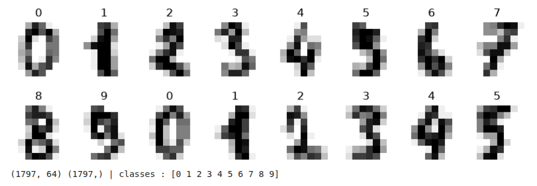
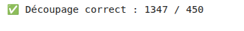
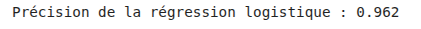
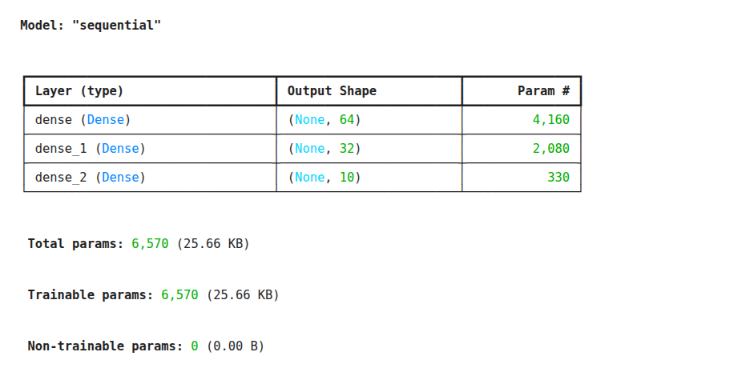
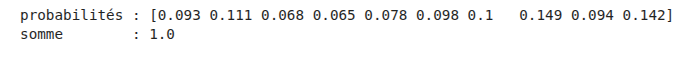
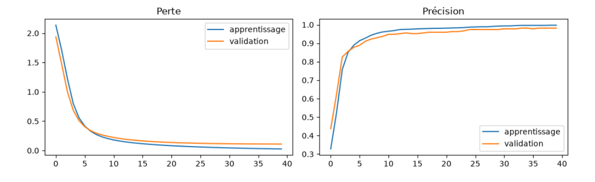
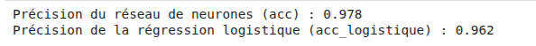
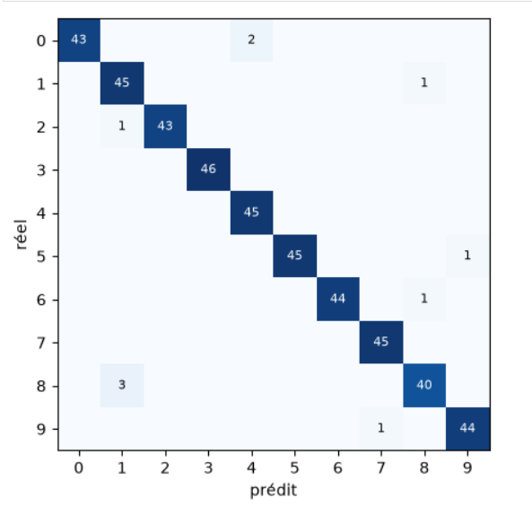
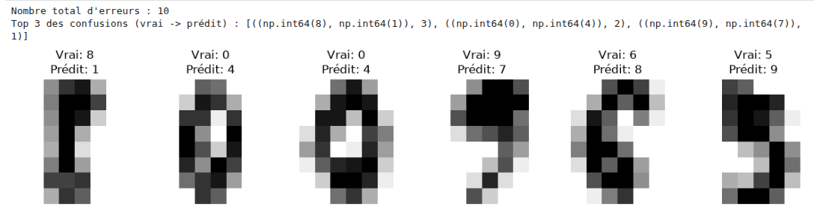

# TP3 — Reconnaissance de chiffres (Multiclasses)

## 0. Initialisation de l'environnement

Ce premier bloc configure l'environnement d'exécution : il désactive les messages de log superflus de TensorFlow (`TF_CPP_MIN_LOG_LEVEL`), importe les bibliothèques indispensables (NumPy pour les tableaux, Pandas pour la manipulation de données, Matplotlib pour les visualisations, Scikit-Learn pour les jeux de données et le découpage, ainsi que Keras pour la construction du réseau de neurones). 

Enfin, il fixe une graine aléatoire (`set_random_seed(42)`). **Pourquoi fixer cette graine ?** En intelligence artificielle, les poids initiaux du réseau sont initialisés de manière aléatoire. Fixer ce nombre (le fameux `42`) garantit que le hasard sera exactement le même à chaque exécution du code. C'est extrêmement rassurant quand on apprend : cela permet d'obtenir les mêmes résultats sur sa machine, de comparer facilement son code avec un camarade ou de suivre un correctif sans surprise !

```python
import os
os.environ["TF_CPP_MIN_LOG_LEVEL"] = "3"  # Masque les messages de log superflus de TensorFlow
import numpy as np, pandas as pd, matplotlib.pyplot as plt
from sklearn.model_selection import train_test_split
from sklearn.preprocessing import StandardScaler
from sklearn.metrics import r2_score, mean_absolute_error, confusion_matrix, precision_score, recall_score
from tensorflow import keras
from tensorflow.keras import layers, regularizers

# Fixation de la graine aléatoire pour assurer la reproductibilité des poids du réseau
keras.utils.set_random_seed(42)

def controle(condition, ok, ko):
    """Fonction utilitaire pour valider les étapes du TP."""
    print("✅", ok) if condition else print("❌", ko)
```

---

## Étape 1 — Les données : des chiffres écrits à la main

Le jeu de données `load_digits` contient **1 797 images miniatures de 8 × 8 pixels**, représentant chacune un chiffre de 0 à 9.

- **Intensité des pixels** : Chaque pixel possède une valeur brute allant de `0` (blanc) à `16` (noir).
- **Normalisation (division par 16.0)** : Au lieu de garder des valeurs brutes de 0 à 16, on divise par 16 pour ramener toutes les intensités dans l'intervalle $[0, 1]$. C'est un peu comme convertir des notes sur une échelle de 0 à 1 (ou sous forme de pourcentages). Cette étape est cruciale pour aider l'algorithme à ne pas s'emmêler les pinceaux lors des calculs mathématiques et pour éviter la saturation des neurones.
- **Aplatissement (*Flattening*)** : Une image de $8 \times 8$ pixels est une grille carrée en 2 dimensions (2D). Cependant, un réseau de neurones dense (*Fully-Connected*) s'attend à recevoir une longue ligne de nombres à la suite (1 dimension / 1D). On peut imaginer le réseau un peu comme une longue file de caisses enregistreuses : il ne sait lire qu'une longue liste ordonnée de valeurs, et non une grille carrée. Chaque image est donc aplatie en un vecteur de **64 caractéristiques** ($8 \times 8 = 64$).

```python
from sklearn.datasets import load_digits

# Chargement du jeu de données des chiffres manuscrits depuis scikit-learn
chiffres = load_digits()

# Affichage visuel d'un échantillon d'images avec leur étiquette (label) associée
fig, axes = plt.subplots(2, 8, figsize=(10, 3))
for ax, img, lab in zip(axes.ravel(), chiffres.images, chiffres.target):
    ax.imshow(img, cmap="gray_r")
    ax.set_title(lab)
    ax.axis("off")
plt.show()

# Normalisation des caractéristiques (division par 16.0 pour obtenir des valeurs entre 0 et 1)
X = chiffres.data / 16.0
y = chiffres.target

# Vérification des dimensions des données et des classes cibles uniques
print("Dimensions de X (images aplaties) :", X.shape)
print("Dimensions de y (étiquettes) :", y.shape)
print("Classes uniques présentes :", np.unique(y))
```



---

##  Étape 2 — Découper (Entraînement vs Test)

Avant de confier nos images à un modèle, il est indispensable de séparer notre jeu de données en deux parties bien distinctes :

1. **Le jeu d'entraînement (`X_train`, `y_train`)** : C'est le « manuel scolaire » avec lequel le réseau va étudier et apprendre à reconnaître les chiffres.
2. **Le jeu de test (`X_test`, `y_test`)** : C'est l'« examen final ». Ces images sont mises de côté et **jamais montrées** au modèle pendant qu'il apprend. Cela permet de tester sa vraie capacité à généraliser sur de nouvelles écritures qu'il n'a jamais vues.

- **Pourquoi une taille de test de 25 % (`test_size=0.25`) ?** C'est un grand classique en Machine Learning : on garde la majeure partie des données (75 %, soit 1 347 images) pour l'apprentissage, et un quart (25 %, soit 450 images) pour l'évaluation rigoureuse.
- **Pourquoi la stratification (`stratify=y`) est cruciale ici ?** Contrairement à un problème simple à deux choix (oui/non), nous avons ici **10 classes** (les chiffres de 0 à 9). Si on mélangeait les données complètement au hasard sans stratifier, le hasard pourrait faire que le chiffre '8' ou '3' se retrouve en quantité trop faible (voire absente) dans le jeu de test. La stratification force l'algorithme à **conserver exactement la même proportion de chaque chiffre** dans le jeu d'entraînement et dans le jeu de test.
- **Le rôle de `random_state=42`** : Comme le mélange des images au moment du découpage se fait de manière aléatoire, fixer ce paramètre garantit que le brassage des cartes sera toujours rigoureusement le même à chaque exécution, facilitant le travail en équipe ou le suivi du TP.

```python
# Découpage du jeu de données en ensembles d'entraînement (75%) et de test (25%)
X_train, X_test, y_train, y_test = train_test_split(
    X, y,
    test_size=0.25,     # 25% des données réservées pour l'examen final
    stratify=y,         # Garantit une répartition équilibrée de chaque chiffre (0 à 9)
    random_state=42     # Fixe la façon aléatoire de mélanger les données pour la reproductibilité
)
```

```python
# ✅ Contrôle (ne pas modifier)
controle(X_train.shape == (1347, 64) and X_test.shape == (450, 64), 'Découpage correct : 1347 images d\'entraînement / 450 images de test', 'Attendu (1347, 64) et (450, 64)')
```


---

##  Étape 3 — La référence (Le modèle de base / Baseline)

En Machine Learning, il y a une règle d'or absolue : avant de se lancer dans la construction d'un réseau de neurones complexe, il faut toujours comparer ses performances à une méthode simple et rapide. C'est ce qu'on appelle une **baseline** (ou modèle de référence).

### Pourquoi est-ce indispensable ?
Si notre futur réseau de neurones sophistiqué obtient 92 % de bonnes réponses, cela semble formidable... Sauf si un modèle ultra-simple en ligne droite atteint 95 % sans effort ! Établir une référence nous permet de savoir si notre réseau apporte réellement une valeur ajoutée.

### Qu'est-ce que la régression logistique ?
Malgré son nom qui contient le mot « régression », la **régression logistique** est en réalité l'un des algorithmes de classification les plus classiques et robustes en apprentissage automatique.

* Contrairement à une ligne droite de régression classique, elle utilise une fonction mathématique spéciale (la fonction logistique ou sigmoïde) pour estimer la probabilité qu'une image appartienne à une classe donnée.
* C'est un modèle linéaire : il cherche à tracer des frontières droites pour séparer nos différents chiffres dans l'espace à 64 dimensions.

### Pourquoi `max_iter=3000` ?
Lorsqu'un modèle linéaire s'entraîne, il utilise un algorithme d'optimisation (une méthode numérique) pour trouver les meilleurs réglages (les poids) pas à pas. Sur des jeux de données avec plusieurs classes comme ici, l'algorithme peut parfois avoir besoin de plus d'étapes que la valeur par défaut (souvent 100). En fixant `max_iter=3000`, on donne un « temps de calcul maximum » suffisant (3 000 itérations) pour être sûr que l'algorithme trouve la solution optimale sans s'interrompre prématurément.

```python
from sklearn.linear_model import LogisticRegression

# 1. Initialisation du modèle de référence (on autorise jusqu'à 3000 étapes d'optimisation)
modele_logistique = LogisticRegression(max_iter=3000)

# 2. Apprentissage : le modèle analyse le "manuel scolaire" (les images et étiquettes d'entraînement)
modele_logistique.fit(X_train, y_train)

# 3. Évaluation : on teste le modèle sur l'examen final (le jeu de test) et on récupère sa précision (accuracy)
acc_logistique = modele_logistique.score(X_test, y_test)

# Affichage du score sous forme de pourcentage ou de décimale (ex: 0.965 pour 96.5%)
print(f"Précision de la régression logistique : {acc_logistique:.3f}")
```



```python
# ✅ Contrôle automatique (ne pas modifier)
controle(acc_logistique > 0.94, 'Référence établie : %.3f' % acc_logistique, 'Attendu une précision supérieure à 0.94')
```


---

##  Étape 4 — Construire le réseau de neurones (Classification multiclasse)

Jusqu'à présent, nous avons manipulé des problèmes binaires (oui/non, 0 ou 1). Désormais, nous devons reconnaître **10 chiffres différents** (de 0 à 9). L'architecture de notre réseau de neurones doit donc s'adapter à cette complexité.

### Pourquoi 10 neurones en couche de sortie et une activation `softmax` ?
* **La couche de sortie à 10 neurones** : Puisque nous cherchons à classer nos images dans 10 catégories distinctes, la dernière couche de notre réseau doit posséder exactement **10 neurones** (un par chiffre).
* **L'activation `softmax`** : Contrairement à la fonction sigmoïde qui ne gère qu'un choix binaire (entre 0 et 1), la fonction mathématique **`softmax`** est spécialement conçue pour les problèmes multiclasses. Elle transforme les scores bruts du réseau en **10 probabilités** distinctes (comprises entre 0 et 1), dont **la somme totale fait exactement 1 (ou 100 %)**. Chaque neurone de sortie représente ainsi la probabilité que l'image corresponde à un chiffre donné.

### Pourquoi la perte `sparse_categorical_crossentropy` ?
* Pour mesurer l'erreur de notre modèle sur plusieurs classes, on utilise la **crossentropy catégorielle**.
* Le préfixe **`sparse`** (clairsemé/creux) est extrêmement important ici : il indique à Keras que nos étiquettes (`y_train` et `y_test`) sont fournies sous forme **d'entiers simples** (de 0 à 9) plutôt que sous forme de vecteurs de one-hot encoding (comme `[0, 0, 1, 0, 0, 0, 0, 0, 0, 0]`). Cela simplifie grandement la manipulation des données tout en effectuant la même correction mathématique rigoureuse.

```python
# Fixation de la graine pour garantir la reproductibilité de l'initialisation du réseau
keras.utils.set_random_seed(42)

# Construction du modèle séquentiel couche par couche
modele = keras.Sequential([
    layers.Input(shape=(64,)),                 # Couche d'entrée : attend nos vecteurs de 64 pixels aplatis
    layers.Dense(64, activation="relu"),       # 1ère couche cachée de 64 neurones avec activation ReLU (détection de motifs)
    layers.Dense(32, activation="relu"),       # 2ème couche cachée de 32 neurones avec activation ReLU (synthèse des caractéristiques)
    layers.Dense(10, activation="softmax")     # Couche de sortie : 10 neurones avec softmax (probabilités pour chaque chiffre de 0 à 9)
])

# Compilation du modèle : choix de l'optimiseur, de la fonction de perte et de la métrique d'évaluation
modele.compile(
    optimizer="adam",                          # Optimiseur Adam : ajuste efficacement les poids du réseau
    loss="sparse_categorical_crossentropy",    # Perte adaptée aux multiclasses avec des étiquettes sous forme d'entiers
    metrics=["accuracy"]                       # Métrique suivie : la précision (part de bonnes prédictions)
)

# Affichage du résumé de l'architecture du réseau (nombre de couches et de paramètres)
modele.summary()
```


---

##  Étape 5 — Avant l'entraînement : que répond le réseau ?

Avant même d'apprendre quoi que ce soit, notre réseau de neurones possède une structure complète (ses couches, ses neurones, ses connexions), mais ses **poids synaptiques** (les coefficients de pondération) viennent d'être initialisés de manière totalement aléatoire. 

### Que se passe-t-il si on lui soumet une image de test à ce stade ?
Puisque le réseau n'a encore jamais vu d'exemples et ne sait pas analyser l'image, il réagit **à peu près au hasard** :

- **Des probabilités dispersées** : Si l'on observe les 10 probabilités de sortie (pour les chiffres de 0 à 9), on s'aperçoit qu'elles sont toutes assez proches les unes des autres (par exemple entre 0.06 et 0.15). Aucune classe ne se détache vraiment du lot, car le réseau est totalement indécis et navigue à l'aveugle.
- **La signature de la fonction `softmax`** : Même si le modèle répond au hasard le plus total, la somme de ces 10 probabilités fait toujours exactement **1.0** (soit 100 %). C'est la propriété mathématique fondamentale de la couche `softmax` que nous avons configurée à l'étape précédente : elle force les scores du réseau à se comporter comme de vraies proportions dont le total fait 100 %.


```python
# Demande au modèle de prédire la classe de la toute première image du jeu de test (X_test[:1])
# verbose=0 permet d'éviter l'affichage de messages superflus pendant la prédiction
p = modele.predict(X_test[:1], verbose=0)[0]

# Affichage des 10 probabilités de sortie arrondies à 3 décimales près
print("probabilités :", np.round(p, 3))

# Vérification mathématique que la somme de toutes les probabilités fait bien 1.0
print("somme        :", round(float(p.sum()), 3))
```



---

##  Étape 6 — Entraîner le réseau de neurones

C'est le moment où le modèle passe de la théorie à la pratique ! L'entraînement (ou phase d'apprentissage) consiste à faire passer nos exemples d'images en boucle au réseau pour qu'il ajuste ses poids internes grâce à l'algorithme de rétropropagation du gradient.

### Décryptage des hyperparamètres de l'entraînement :
* **`epochs=40` (Les époques)** : Une époque correspond à un passage complet de l'ensemble de nos données d'entraînement à travers le réseau. Ici, nous demandons au modèle de revoir et d'étudier ses exemples **40 fois de suite** pour affiner sa compréhension et corriger ses erreurs progressivement.
* **`batch_size=32` (La taille des lots)** : Au lieu de modifier les réglages du réseau image par image (ce qui serait instable) ou pour toutes les images d'un coup (ce qui demanderait trop de mémoire), on regroupe les images par petits **paquets de 32**. Le réseau fait un petit bilan et ajuste ses poids après chaque lot de 32 images.
* **`validation_split=0.2` (La validation croisée interne)** : Keras met automatiquement de côté **20 %** du jeu d'entraînement pour tester le modèle à la fin de chaque époque (sans utiliser ces données pour apprendre). Cela permet de surveiller si le réseau progresse bien en temps réel et de détecter d'éventuels signes de surapprentissage (*overfitting*).
* **`verbose=0`** : Permet de désactiver l'affichage en direct des lignes de progression pour garder un carnet propre et lisible. Tout est stocké discrètement dans la variable `histoire`.


```python
# Lancement de l'entraînement du modèle et sauvegarde du suivi dans la variable "histoire"
histoire = modele.fit(
    X_train, y_train,
    epochs=40,               # Nombre de fois que le réseau va parcourir les données (40 passages)
    batch_size=32,           # Nombre d'images traitées en même temps avant chaque correction de poids (32)
    validation_split=0.2,    # 20% des données d'entraînement réservées pour surveiller l'apprentissage en direct
    verbose=0                # Masque les affichages de logs pendant l'entraînement pour plus de propreté
)

print("Entraînement terminé avec succès !")
```

---

##  Étape 7 — Visualiser les courbes d'apprentissage (Perte et Précision)

Une fois l'entraînement terminé, il ne faut jamais se contenter d'un simple chiffre de fin : il faut **visualiser l'historique** sous forme de graphiques. C'est le seul moyen de savoir si le modèle a bien appris ou s'il rencontre des difficultés.

### Comment lire ces deux graphiques ?

Le code génère deux courbes côte à côte (grâce à `plt.subplots`) pour suivre l'évolution sur les 40 époques :

1. **Le graphique de gauche : La Perte (*Loss*)**
   - **Ce qu'il mesure** : L'erreur du modèle (l'écart entre ce qu'il prédit et la réalité). Plus la valeur est basse, meilleur c'est.
   - **Ce qu'on veut voir** : Les courbes d'**apprentissage** (bleue) et de **validation** (orange) doivent chuter rapidement au début, puis se stabiliser en bas vers une valeur proche de zéro.

2. **Le graphique de droite : La Précision (*Accuracy*)**
   - **Ce qu'il mesure** : Le pourcentage de bonnes réponses données par le modèle (sur une échelle de 0 à 1, où 1 représente 100 % de réussite).
   - **Ce qu'on veut voir** : Les deux courbes doivent monter rapidement vers le haut. On observe ici qu'elles frôlent les 0.98 / 0.99, ce qui indique une excellente reconnaissance des chiffres !

### L'œil du lynx : repérer le surapprentissage (*Overfitting*)
En observant l'écart entre la courbe bleue (entraînement) et la courbe orange (validation) :
- Si la courbe bleue continue de monter vers la perfection tandis que la courbe orange commence à stagner ou à redescendre, cela signifierait que le modèle **apprend par cœur** ses exemples d'entraînement au lieu de comprendre la logique générale (*surapprentissage*).
- Ici, les deux courbes évoluent de manière très proche et harmonieuse, ce qui prouve que notre modèle généralise à merveille sur de nouvelles images qu'il n'a jamais vues !


```python
# Récupération de l'historique de l'entraînement stocké dans l'objet "histoire"
h = histoire.history

# Création d'une figure contenant deux graphiques côte à côte (1 ligne, 2 colonnes)
fig, ax = plt.subplots(1, 2, figsize=(10, 3.2))

# 1er graphique : Évolution de la perte (Loss) pour l'entraînement et la validation
ax[0].plot(h["loss"], label="apprentissage")
ax[0].plot(h["val_loss"], label="validation")
ax[0].set_title("Perte")
ax[0].legend()

# 2e graphique : Évolution de la précision (Accuracy) pour l'entraînement et la validation
ax[1].plot(h["accuracy"], label="apprentissage")
ax[1].plot(h["val_accuracy"], label="validation")
ax[1].set_title("Précision")
ax[1].legend()

# Ajustement automatique de l'espacement et affichage des graphiques
plt.tight_layout()
plt.show()
```



---

##  Étape 8 — Évaluer sur le jeu de test

Maintenant que notre réseau a terminé son apprentissage, l'heure de vérité a sonné ! Nous allons évaluer ses performances sur le jeu de test (les 450 images de l'« examen final » qu'il n'a jamais vues auparavant).

### De la probabilité à la décision : Le rôle de `argmax`
- Puisque la couche de sortie de notre réseau utilise une activation `softmax`, la fonction `predict()` renvoie pour chaque image **10 probabilités** (par exemple : 1 % de chance que ce soit un 0, 85 % que ce soit un 3, 2 % que ce soit un 5, etc.).
- Pour prendre une décision tranchée, il nous faut identifier **quel est le chiffre qui a obtenu la plus forte probabilité**. C'est exactement le rôle de la fonction mathématique **`np.argmax(..., axis=1)`** : elle parcourt les 10 scores de chaque image et sélectionne l'indice (de 0 à 9) du neurone qui a crié le plus fort.

### La matrice de confusion
Pour aller plus loin qu'un simple pourcentage de réussite, on utilise une **matrice de confusion**. C'est un tableau croisé qui permet de voir en détail si le modèle confond certains chiffres (par exemple, s'il prend parfois un '4' pour un '9' ou un '3' pour un '8').

### Comparaison avec la Baseline (Régression Logistique)
En comparant la précision du réseau de neurones ($97.8\,\%$) à celle de la régression logistique établie à l'étape 3 ($96.2\,\%$), on constate que notre réseau de neurones apporte un gain de performance intéressant, prouvant l'utilité des couches cachées !


```python
from sklearn.metrics import confusion_matrix

# 1. Prédiction sur l'ensemble du jeu de test et conversion des 10 probabilités en un seul chiffre prédit (grâce à np.argmax)
y_pred = np.argmax(modele.predict(X_test, verbose=0), axis=1)

# 2. Calcul de la précision globale (pourcentage de prédictions correctes)
acc = np.mean(y_pred == y_test)

# 3. Génération de la matrice de confusion (comparaison détaillée entre les vrais chiffres et les prédictions)
matrice = confusion_matrix(y_test, y_pred)

# Affichage des résultats comparatifs
print(f"Précision du réseau de neurones (acc) : {acc:.3f}")
print(f"Précision de la régression logistique (acc_logistique) : {acc_logistique:.3f}")
```




---

##  Étape 9 — Visualiser la matrice de confusion en image

Obtenir un score global de 97,8 % de bonnes réponses, c'est formidable. Mais pour progresser en intelligence artificielle, un bon data scientist veut savoir **où** et **comment** le modèle se trompe. Est-ce qu'il confond le '3' avec le '8' ? Est-ce qu'il a du mal avec le '1' ? 

La **matrice de confusion** est un tableau croisé (ici sous forme de grille colorée) qui compare les vrais chiffres de notre jeu de test avec les prédictions faites par le réseau.

### Comment lire cette grille pas à pas ?

- **L'axe vertical (le « réel »)** : Il représente le véritable chiffre qui était écrit sur l'image à l'origine (de 0 à 9).
- **L'axe horizontal (le « prédit »)** : Il représente le chiffre qu'a deviné notre réseau de neurones.

#### 1. La diagonale principale (les carrés foncés du haut-gauche vers le bas-droite)
- C'est la zone de la victoire ! Tous les carrés situés sur cette diagonale représentent les **bonnes réponses**. 
- Par exemple, sur la ligne du haut (le chiffre `0`), le carré croisé avec la colonne `0` contient la valeur `43` (en bleu foncé). Cela signifie que le réseau a rencontré 43 images du chiffre '0' et qu'il a correctement deviné '0' à chaque fois. Plus les carrés de cette diagonale sont sombres et remplis, meilleur est le modèle !

#### 2. Tout ce qui est hors de la diagonale (les erreurs)
- Le moindre petit carré qui s'allume en dehors de cette diagonale représente **une erreur commise par le réseau**.
- **Exemple concret à lire sur l'image** : Tout en bas, sur la ligne du chiffre `8`, si l'on regarde la colonne `1`, on aperçoit un petit carré clair avec le chiffre `3`. Qu'est-ce que cela veut dire ? Cela signifie que sur l'ensemble du test, le modèle a pris un **'8' pour un '1' à 3 reprises**. C'est une confusion classique car, selon l'écriture manuscrite, certains '8' mal formés peuvent ressembler à des '1'.


```python
# Définition de la taille de la figure pour l'affichage graphique
plt.figure(figsize=(6, 5))

# Affichage de la matrice de confusion sous forme de carte de chaleur (colormap "Blues")
plt.imshow(matrice, cmap="Blues")

# Boucles pour parcourir chaque case de la grille (10x10) et y inscrire le nombre d'images correspondant
for i in range(10):
    for j in range(10):
        if matrice[i, j]:  # N'affiche que les cases qui contiennent au moins une valeur
            # Écrit le nombre au centre de la case. La couleur du texte s'adapte (blanc sur fond sombre, bleu sur fond clair)
            plt.text(j, i, matrice[i, j], ha="center", va="center", fontsize=8, 
                     color="white" if matrice[i, j] > matrice.max() / 2 else "blue")

# Ajout des labels sur les axes et des graduations pour les chiffres de 0 à 9
plt.xlabel("prédit")
plt.ylabel("réel")
plt.xticks(range(10))
plt.yticks(range(10))

# Affichage final de la matrice en image
plt.show()
```



---

##  Étape 10 — Analyser les erreurs (Inspecter ce que le modèle a raté)

Maintenant que nous savons **où** se situent les erreurs grâce à la matrice de confusion, nous allons pousser l'investigation jusqu'à l'extrême : **afficher les véritables images** sur lesquelles le réseau de neurones s'est trompé. C'est le meilleur moyen de comprendre si l'erreur vient d'un manque d'intelligence du modèle ou simplement d'une écriture humaine illisible !

### Comment traquer les erreurs ?
1. **Identifier les différences** : On compare le tableau des prédictions (`y_pred`) avec le tableau des vraies valeurs (`y_test`). Si `y_pred != y_test`, c'est que le modèle a commis une erreur.
2. **Récupérer les indices** : On isole la position exacte de ces images ratées dans notre jeu de test.
3. **Compter les confusions les plus fréquentes** : On utilise l'outil `Counter` de Python pour lister les paires de chiffres qui se trompent le plus souvent (par exemple : combien de fois un '4' a été pris pour un '9' ?).
4. **Afficher les coupables** : On trace à l'écran les images miniatures de ces échecs en affichant clairement au-dessus ce qui était écrit (le réel) et ce qu'a cru voir le réseau (la prédiction erronée).

```python
from collections import Counter
import matplotlib.pyplot as plt

# 1. Identifier les indices du jeu de test où la prédiction est différente de la réalité
indices_erreurs = np.where(y_pred != y_test)[0]
print(f"Nombre total d'erreurs commises sur le jeu de test : {len(indices_erreurs)} sur {len(y_test)} images.")

# 2. Compter les types de confusions les plus fréquentes (ex: "vrai 8 pris pour 1")
erreurs_paires = [(y_test[i], y_pred[i]) for i in indices_erreurs]
frequence_erreurs = Counter(erreurs_paires)

print("\nTop des confusions les plus fréquentes (Vrai -> Prédit à tort) :")
for (vrai, pred), count in frequence_erreurs.most_common(5):
    print(f"Le chiffre {vrai} a été pris pour un {vrai} -> {pred} : {count} fois")

# 3. Afficher en image quelques-unes de ces erreurs (par exemple les 10 premières)
nb_a_afficher = min(10, len(indices_erreurs))
fig, axes = plt.subplots(2, 5, figsize=(10, 4))
axes = axes.ravel()

for idx, i in enumerate(indices_erreurs[:nb_a_afficher]):
    # Récupérer l'image aplatie et la remettre sous sa forme de grille 8x8 pixels
    image_8x8 = X_test[i].reshape(8, 8)
    
    # Afficher l'image en nuances de gris
    axes[idx].imshow(image_8x8, cmap="gray")
    axes[idx].axis("off")
    
    # Indiquer en titre le vrai chiffre vs le chiffre prédit par erreur
    axes[idx].set_title(f"Réel: {y_test[i]}\nPrédit: {y_pred[i]}", color="red", fontsize=9)

plt.tight_layout()
plt.show()
```




###  Indice et explications pour bien comprendre :

* **Pourquoi `.reshape(8, 8)` ?** Souviens-toi qu'à l'étape 1, nous avions aplati (*flatten*) nos images de $8 \times 8$ pixels en une longue ligne de 64 chiffres pour que le réseau de neurones puisse les lire. Pour les réafficher sous forme de dessin dans Matplotlib, il faut impérativement leur redonner leur forme de carré d'origine en 2D grâce à `.reshape(8, 8)`.
* **Ce que tu vas observer** : En regardant les images affichées par ce code, tu remarqueras souvent que les erreurs du réseau sont tout à fait pardonnables : un '4' très mal fermé, un '1' penché ou un '8' ouvert qui ressemble à s'y méprendre à un '3'. Même les humains s'y tromperaient !


###  Questions de réflexion et de synthèse

#### 1. Les erreurs vous paraissent-elles raisonnables ? Un humain se tromperait-il sur ces images ?
Oui, ces erreurs sont tout à fait raisonnables. En raison de la très faible résolution de $8 \times 8$ pixels et des variations d'écriture d'une personne à l'autre, certains chiffres sont particulièrement ambigus. Un être humain pourrait lui aussi facilement hésiter ou se tromper sur ces échantillons de basse qualité.

#### 2. Pourquoi une sortie `softmax` plutôt qu'une sigmoïde ici ? Que change `sparse_categorical_crossentropy` par rapport à `binary_crossentropy` ?
On utilise `softmax` car le problème comporte **10 classes différentes** : elle permet de distribuer la probabilité sur les 10 chiffres de façon à ce que le total fasse exactement 100 %, contrairement à la sigmoïde qui se limite strictement à un choix binaire (oui/non). De même, `sparse_categorical_crossentropy` sert de fonction de perte adaptée à ces multiples options avec des étiquettes sous forme d'entiers, là où la version `binary` ne gère que deux issues.

---

##  Ce qu'il faut retenir

**Classification multiclasse** : 
* Couche de sortie à **N neurones** (autant que de classes, soit 10 ici) avec une fonction d'activation **`softmax`** (qui produit des probabilités pour chaque classe dont la somme totale fait toujours $1$).
* Fonction de perte **`sparse_categorical_crossentropy`**, idéale pour mesurer l'erreur sur plusieurs classes avec des étiquettes fournies sous forme d'entiers simples.

---

**Méthodologie & Reproductibilité** : 
* Toujours fixer la graine aléatoire (`keras.utils.set_random_seed(42)`) pour garantir la reproductibilité de l'initialisation du réseau et des résultats d'entraînement.
* Toujours effectuer un découpage stratifié (*stratified split*) pour conserver des proportions équilibrées de chaque chiffre dans les jeux d'entraînement et de test.

---

**Décision et Analyse des erreurs** : 
* La réponse finale du réseau s'obtient en sélectionnant la classe de plus forte probabilité grâce à **`argmax`**.
* La **matrice de confusion** (visualisée sous forme de carte thermique) permet d'aller au-delà de la simple précision globale (*accuracy*) pour identifier précisément les confusions commises par le modèle (ex: confondre un '8' avec un '1').

---

**Aplatissement et Limites des réseaux denses** : 
* Pour injecter une image en 2D (comme nos grilles de $8 \times 8$ pixels) dans un réseau dense, il est nécessaire de l'**aplatir** (*flatten*) en un vecteur de 64 dimensions, ce qui entraîne la perte de la structure spatiale native — une limitation majeure que les réseaux de convolution (CNN) viendront résoudre au **TP4**.

---

## 11. Conclusion & Mot de la fin

Ce TP illustre à merveille la transition vers la classification multiclasse et l'évaluation fine d'un réseau de neurones :

* **De la binarité à la multiclasse** : Alors qu'un modèle binaire se contente d'un choix oui/non via une sigmoïde, le réseau multiclasse exploite une architecture à 10 neurones et une activation `softmax` pour distribuer finement la confiance du modèle sur l'ensemble des chiffres.
* **La rigueur méthodologique et visuelle** : La performance brute de près de 98 % ne suffit pas. C'est l'inspection minutieuse des courbes d'apprentissage et de la matrice de confusion qui permet de valider la robustesse du modèle et de comprendre la nature pardonnable des erreurs commises face à des écritures humaines ambiguës.
* **Le mot de la fin** : En apprentissage profond, comprendre ce que le réseau rate est tout aussi formateur que de mesurer ce qu'il réussit. L'analyse des échecs confirme que les erreurs du modèle (souvent dues à des tracés ambigus) rejoignent les hésitations humaines, témoignant d'un apprentissage pertinent et généralisable.

---

> **Ressource associée** : Tu peux retrouver et télécharger le notebook complet de ce TP directement sur GitHub : 
> 👉 <a href="https://github.com/GregoryElBajoury/deep-learning-workshops/blob/main/enonces/ENONCES/tp3_multiclasses.ipynb" target="_blank" rel="noopener noreferrer">Accéder au notebook <code>tp3_multiclasses.ipynb</code></a>